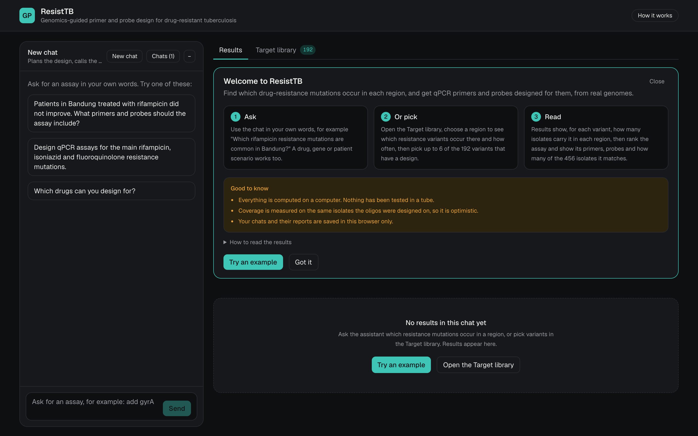
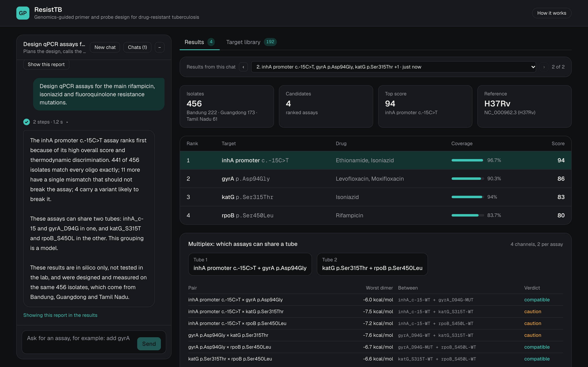
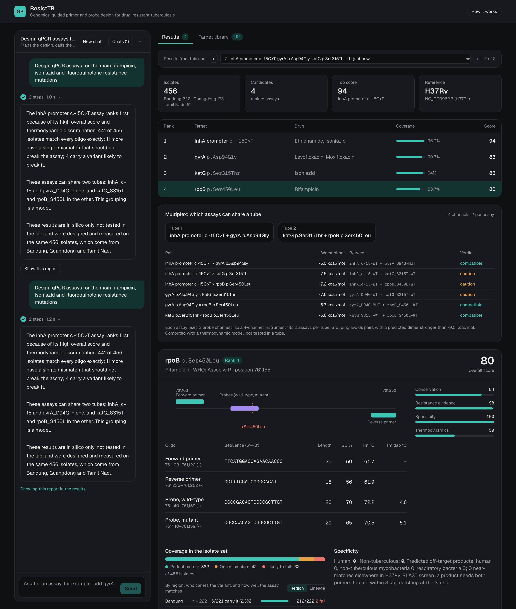
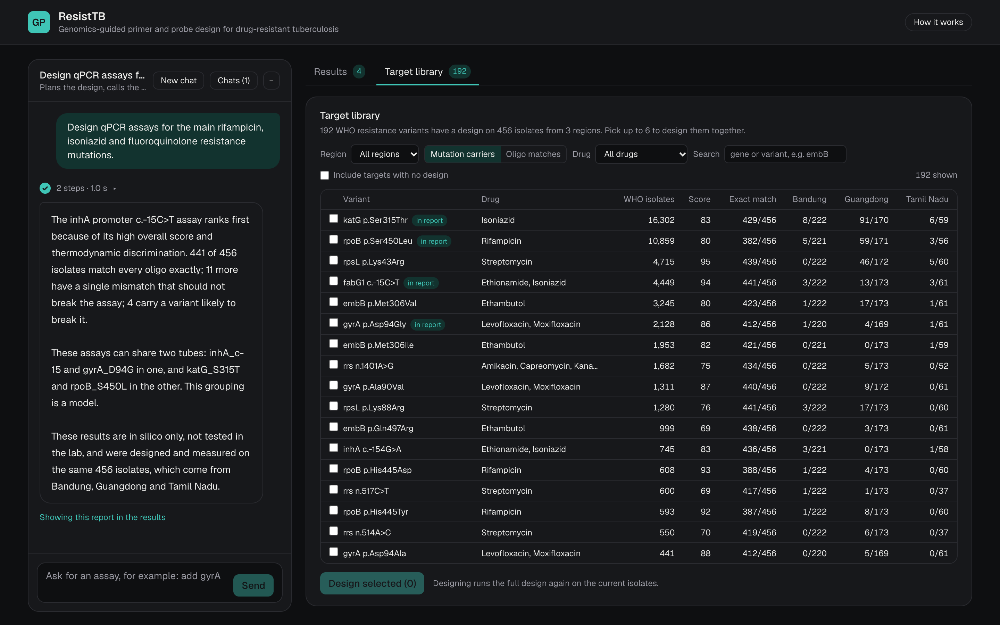

# ResistTB

**Design qPCR primers and probes that detect drug-resistant tuberculosis, using real bacterial genomes.**

Live demo: **<https://resist-tb.afanhandoyo.com>** · GenoHack 2026 prototype · everything is _in silico_ (computer-only; nothing has been tested in a lab tube yet).



---

## Contents

1. [What problem does this solve?](#what-problem-does-this-solve)
2. [What ResistTB does](#what-resisttb-does)
3. [A tour of the app](#a-tour-of-the-app)
4. [Key numbers](#key-numbers)
5. [How it works](#how-it-works)
6. [How to read a score](#how-to-read-a-score)
7. [Honest limitations](#honest-limitations)
8. [Why it matters](#why-it-matters)
9. [For developers](#for-developers) — architecture, install, run, test, deploy
10. [Repository map](#repository-map) · [Further reading](#further-reading) · [Team and data credits](#team-and-data-credits)

---

## What problem does this solve?

Tuberculosis (TB) is treated with a cocktail of antibiotics. Some strains have **mutations** (single-letter changes in their DNA) that make a drug stop working, for example a change in the _rpoB_ gene defeats rifampicin. Picking the wrong drugs wastes weeks and breeds more resistance.

A fast, cheap way to spot these mutations is **qPCR**: a small lab test that copies a short stretch of DNA (using **primers**) and lights up when it finds the exact sequence it was built for (using a **probe**). The catch is that a qPCR test is only as good as its design:

- TB strains differ between regions. A primer that works on one country's strains may miss another's.
- Primers must not accidentally copy human DNA or other bacteria.
- Several tests have to share one tube without sticking to each other.

Designing this by hand for dozens of mutations, across regional strain diversity, is slow. ResistTB automates it.

## What ResistTB does

You ask a question in plain English ("Patients in Bandung did not improve on rifampicin. What should the assay include?") or pick mutations from a library. ResistTB then:

1. **Designs** primers and allele-specific probes for each drug-resistance mutation.
2. **Checks them against 456 real TB genomes** from Indonesia (Bandung), China (Guangdong) and India (Tamil Nadu): how many strains would the test catch perfectly, how many partly, how many would it miss?
3. **Screens for mistakes**: would the primers copy human DNA or related bacteria? Do they clump together?
4. **Scores and ranks** the designs and suggests which tests can share a tube.
5. **Explains the result** in a chat, without ever inventing numbers (the AI only describes figures computed by the software).

It covers **205 resistance mutations from the WHO mutation catalogue** (192 successfully designed), for drugs including isoniazid, rifampicin, fluoroquinolones, ethambutol, pyrazinamide, streptomycin and more.

## A tour of the app

**1. Ask, or pick.** A welcome card explains the three steps. Type a question in your own words, or browse the library.


**2. Read the ranked results.** Each assay gets a 0–100 score, the drug it relates to, and the share of the 456 strains it matches. The "Multiplex" panel shows which assays can safely share a tube.



**3. Open an assay for the details.** The exact primer and probe sequences, where they sit on the gene, melting temperatures, a coverage bar (perfect match / one mismatch / likely to fail), a split by region or by TB lineage, and the off-target screen.



**4. Browse the target library.** All 192 designed mutations, filterable by drug and region. See how often each mutation occurs in each region, then tick up to 6 and design them together, no chat needed.



Chats and their reports are saved in your own browser only; there are no accounts and nothing is stored on a server.

## Key numbers

|                                             |                                                                               |
| ------------------------------------------- | ----------------------------------------------------------------------------- |
| TB genomes analysed                         | **456** (Bandung 222, Guangdong 173, Tamil Nadu 61)                           |
| WHO resistance mutations in the library     | **205** (192 designed, 13 explained but not designable)                       |
| Library designs scoring 80 or more (of 100) | 161 of 192                                                                    |
| Headline assays                             | inhA promoter c.-15C>T (94), gyrA D94G (86), katG S315T (83), rpoB S450L (80) |
| Two-tube panel for those four               | inhA + gyrA in tube 1, katG + rpoB in tube 2                                  |

## How it works

1. **Collect public genomes.** Raw sequencing data for TB isolates is downloaded from the public NCBI/ENA archives.
2. **Read each genome.** A cloud computer compares every isolate to the standard TB reference strain (H37Rv) and lists every difference, plus its family (lineage) and known drug-resistance calls. This step is finished; results are stored.
3. **Find a stable place to aim.** Around each resistance mutation, ResistTB builds the "consensus" sequence of all isolates, and avoids spots where strains vary a lot.
4. **Design the oligos.** The primer-design tool Primer3 proposes primer pairs; ResistTB adds two probes, one matching normal DNA and one matching the resistant mutation, and checks how strongly each sticks.
5. **Test against every isolate.** Each design is scored per isolate and per region.
6. **Screen for off-targets.** A BLAST search against human, non-tuberculous mycobacteria and respiratory bacteria flags unwanted products.
7. **Rank and group.** Scores are combined (below) and compatible assays are grouped into tubes.
8. **Explain.** A Gemini AI model on Google Vertex AI turns your question into a design request and describes the result in words.

## How to read a score

The overall score (0–100) is a transparent weighted mix:

| Part                | Weight | Plain meaning                                                                                   |
| ------------------- | ------ | ----------------------------------------------------------------------------------------------- |
| Conservation        | 30%    | How many of the 456 genomes match perfectly                                                     |
| Thermodynamics      | 30%    | Do primers and probes bind at the right temperature, and can the probe tell normal from mutant? |
| Specificity         | 20%    | Does it avoid copying human or other bacterial DNA?                                             |
| Resistance evidence | 20%    | How strongly the WHO catalogue links this mutation to resistance                                |

The weights are a reasonable choice, not a validated clinical formula.

## Honest limitations

- **Computer-only.** No primer has been tested in a lab. Melting temperatures and binding are model estimates.
- **Coverage is optimistic.** It is measured on the same genomes used to design the assays. Held-out validation is the next step.
- **Regions are coarse.** Each region is one study, and Tamil Nadu (61 genomes) is small and mostly one lineage.
- **Not a diagnostic and not clinical advice.** The assistant declines treatment questions.

## Why it matters

- **Faster assay development.** What takes a specialist days per target runs in seconds, with the reasoning shown.
- **Built for local strains.** Designs are checked against regional genomes, so a lab can see in advance where an assay might fail in its own population.
- **Transparent and auditable.** Every number is computed by code, with scores and caveats visible, not generated by an AI.
- **Low running cost.** The prototype runs on a single serverless container that costs close to nothing when idle.
- **Natural next steps:** held-out and leave-one-region-out validation, wet-lab testing with a partner lab, comparison with commercial tests such as Xpert, and more regions.

---

# For developers

## Architecture

```
public reads (NCBI/ENA)
   │  Stage A: cloud VM, Snakemake, per isolate (done)
   ▼  fasterq-dump → rasusa (100x) → snippy (BWA-MEM + FreeBayes) → TB-Profiler
per-isolate results in Google Cloud Storage (456 folders)
   │  Stage B: design library, Python (src/genohack/)
   ▼  snapshot of ±300 bp windows → consensus → Primer3 → probes → coverage → BLAST specificity → score → multiplex
resources/snapshot_windows.npz, design_library.json, offtarget_cache.json
   │  Stage C: agent, API, web
   ▼  Gemini function-calling agent → FastAPI (/api/chat, /api/design, /api/report) → Next.js static site
one container on Cloud Run
```

The deployed container does **not** need the 815 MB of per-isolate files: it reads a 733 KB snapshot (`resources/snapshot_windows.npz`). The BLAST database lives only in the cloud bucket; BLAST results are pre-computed in `resources/offtarget_cache.json`.

## Tech stack and dependencies

| Part                      | Technology                                                                                                                |
| ------------------------- | ------------------------------------------------------------------------------------------------------------------------- |
| Design library            | Python 3.11+ (3.13 in the container), numpy, pandas, primer3-py, biopython                                                |
| Agent                     | Gemini (`gemini-3.5-flash-lite`) on Vertex AI via `google-genai`, up to 5 tool-call turns                                 |
| API                       | FastAPI + uvicorn; server-sent events for chat; per-IP rate limits                                                        |
| Web                       | Next.js 16.4, React 19.3, Tailwind 4, TypeScript; chats in IndexedDB                                                      |
| Genome pipeline (VM only) | Snakemake, snippy 4.6, FreeBayes, BWA-MEM, TB-Profiler 6.6.5 (with `snpeff=5.2`), rasusa, sra-tools, DuckDB (see `envs/`) |
| Specificity (VM only)     | BLAST+ 2.17                                                                                                               |
| Hosting                   | Google Cloud Run + Cloud Storage; Docker (`python:3.13-slim`)                                                             |

Tooling you need locally: **Python 3.11+**, **Node 24 and pnpm 10** (web), and for the AI chat, **Google Cloud credentials** (`gcloud auth application-default login`) with access to Vertex AI.

## Install and run locally

```bash
git clone https://github.com/blueguy42/genohack.git && cd genohack

# Python side
python -m venv .venv && .venv/bin/pip install -e . pytest
```

Reference files are git-ignored: put `NC_000962.3.fasta` and `mask.bed` in `ref/` (see `scripts/setup_vm.sh` for the sources). Without the per-isolate `results/` folder the API uses `resources/snapshot_windows.npz` automatically.

```bash
# API on http://localhost:8000
PYTHONPATH=src .venv/bin/uvicorn genohack.api:app --port 8000
```

```bash
# Web on http://localhost:3000
cd web && pnpm install && pnpm dev
```

Run the tests (35 should pass):

```bash
PYTHONPATH=src .venv/bin/python -m pytest -q
```

## Useful commands

```bash
# Rebuild after data or design changes (run one step at a time and stop on the first error)
bash scripts/sync_results.sh
export PYTHONPATH=src
.venv/bin/python -m genohack.cli snapshot --results results
.venv/bin/python -m genohack.cli library --snapshot resources/snapshot_windows.npz
.venv/bin/python -m genohack.cli report --results results --snapshot resources/snapshot_windows.npz --out web/data/report.json
cd web && pnpm build:site          # static site -> web/site
```

New primer pairs that are not in `resources/offtarget_cache.json` show specificity as "not checked" until BLAST is run on a VM.

## API

| Endpoint           | Purpose                                                                        |
| ------------------ | ------------------------------------------------------------------------------ |
| `GET /api/health`  | Service and model status                                                       |
| `GET /api/report`  | Default report (the four headline assays)                                      |
| `POST /api/chat`   | `{"message": "..."}`; streams `step`, `report`, `text`, `error`, `done` events |
| `POST /api/design` | `{"targets": ["rpoB_S450L"]}`; designs without calling the AI model            |

Configuration through environment variables: `GENOHACK_PROJECT`, `GENOHACK_LOCATION`, `GENOHACK_MODEL`, `GENOHACK_RESULTS`, `GENOHACK_SNAPSHOT`, `GENOHACK_ORIGINS`, and the rate-limit overrides `GENOHACK_CHATS_PER_IP_HOUR/DAY`, `GENOHACK_DESIGNS_PER_IP_HOUR/DAY`.

## Deploy to Cloud Run

```bash
cd web && pnpm build:site && cd ..
gcloud run deploy resisttb --source . --project YOUR_PROJECT_ID --region asia-southeast1 \
  --service-account resisttb-run@YOUR_PROJECT_ID.iam.gserviceaccount.com \
  --min-instances 0 --max-instances 1 --memory 1Gi --cpu 1 --concurrency 4 --timeout 120 \
  --set-env-vars GENOHACK_PROJECT=YOUR_PROJECT_ID,GENOHACK_LOCATION=global
```

Always pass `--project`; the laptop's default gcloud project may differ. The full runbook (domain mapping, rebuilding the VM, BLAST runs, gotchas) is in the handover document.

## Repository map

| Path                                     | Purpose                                                                                             |
| ---------------------------------------- | --------------------------------------------------------------------------------------------------- |
| `src/genohack/`                          | Design library, agent and API (targets, primers, probes, coverage, specificity, scoring, multiplex) |
| `web/`                                   | Next.js interface                                                                                   |
| `tests/`                                 | Automated tests                                                                                     |
| `resources/`                             | Snapshot, design library, WHO catalogue subset, off-target cache, region labels                     |
| `workflow/`, `scripts/`, `envs/`, `sql/` | Per-isolate genome pipeline (Snakemake, shell scripts, conda environments, SRA query)               |
| `infra/`, `Dockerfile`, `deploy/`        | Cloud setup, container and pinned container dependencies                                            |
| `figures/`, `docs/`                      | Validation figures, reports, handover and screenshots                                               |
| `results/`, `ref/`, `fasta_export/`      | Large local data, git-ignored                                                                       |

## Further reading

- [`docs/HANDOVER.md`](docs/HANDOVER.md): full technical handover (data, cloud, decisions, limitations, roadmap, references)
- [`docs/ResistTB_report.pdf`](docs/ResistTB_report.pdf): short status report
- [`docs/pipeline_explained.pdf`](docs/pipeline_explained.pdf) and [`docs/pipeline_overview.pdf`](docs/pipeline_overview.pdf): pipeline diagrams

## Team and data credits

Team: Hanifa Syifa Kamila, Yudisto P Nadapdap, Hefina Aissa Gunawan, Ahmad Alfani Handoyo.

Data and tools: public sequencing data from NCBI SRA/ENA (BioProjects PRJNA1433044, PRJNA1256943, PRJNA898845); H37Rv reference NC_000962.3; WHO mutation catalogue 2023; pipeline structure after the [Nextstrain TB build](https://github.com/nextstrain/tb); Primer3, BLAST+, snippy, TB-Profiler and the other open-source tools listed above. Full references are in the handover document.
